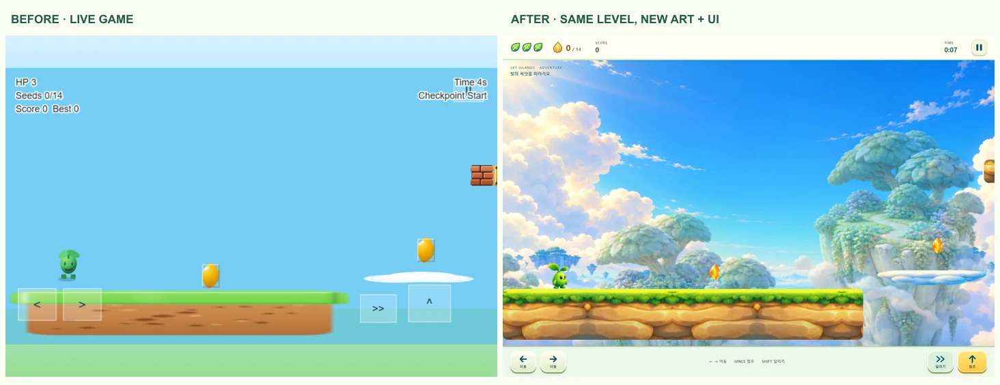

# Sky Sprout 아트·UI 적용 기록

기존 새싹 캐릭터와 하늘섬을 부드러운 입체 일러스트로 발전시킨 UI 리팩토링이다. 초록 새싹, 금빛 씨앗, 구름 발판의 실루엣을 유지하고 시작 화면, 게임 HUD, 터치 버튼, 일시정지·완료·종료 화면에 같은 색과 형태를 사용했다.



## 적용 범위

- 새싹 6개 주요 포즈와 2프레임 달리기, 풀·바위 지형, 구름 발판, 씨앗·벌레·가시·성장 싹·체크포인트·바람 구슬.
- 고정 하늘과 천천히 움직이는 섬 배경, 수집·착지 효과.
- 한국어 시작 화면과 상태창. 체력·씨앗·점수·시간·체크포인트·바람 효과를 표시한다.
- 390×844 세로 및 844×390 가로 화면에 맞는 게임 카메라와 44px 이상 터치 영역. 포인터 캡처로 화면 밖에서 손을 떼어도 입력을 해제하고 일시정지·포커스 상실 때 눌린 상태를 초기화한다.
- 모달 초점 이동 및 Tab 순환, 모션 감소 설정에 따른 새싹 애니메이션 축소.

## 유지한 게임 규칙

기준 커밋은 `077b7a702be0fd4c3810d92bfda9a101711c89b2`이다. `Player`, 모든 적·아이템 엔티티, 물리 상수, `CollisionSystem`, `InputSystem`, `ScoreSystem`, `SaveSystem`, 레벨 데이터, 에디터와 에디터 저장 코드는 변경하지 않았다.

`GameArt`는 기존 물리 객체 옆에 표시 전용 이미지를 추가한다. 원래 객체의 렌더링만 위임하며 좌표·텍스처 크기·body·active/visible·충돌 등록을 바꾸지 않는다. 플레이어 발은 body의 바닥에 맞춘다. 실제 기본 body는 22×34, offset은 (5, 8)이며 `PLAYER.width/height`의 30×42 값과 구분해야 한다. 성장·웅크리기와 피격 깜박임은 기존 body 및 상태를 따라간다.

HUD는 원래 `hud:update` 값을 전달받고, 결과창 버튼은 기존 Phaser 장면의 동작을 호출한다. 메뉴 복귀는 React 시작 화면으로 연결한다. 저장 형식과 키를 바꾸지 않는다.

## 에셋과 파일 위치

- `public/art/sky-sprout-v1/raster/`: PNG 원본에서 변환한 WebP 19개. 배경을 제외한 필요한 알파 채널을 유지했다.
- `public/art/sky-sprout-v1/svg/`: UI와 효과 SVG 16개.
- `public/art/sky-sprout-v1/manifest.json`: 파일별 크기·해상도·알파·SHA-256.
- `src/render/ArtAssets.ts`: 로딩 목록과 경로.
- `src/render/GameArt.ts`: 포즈, 표시 크기, 반복 지형, 수집·착지 효과.
- `src/components/GameOverlay.tsx`, `src/styles/adventure.css`: 반응형 HUD·버튼·결과창.
- `src/game/systems/ScenePanel.ts`, `TouchInputState.ts`: 장면 버튼과 입력 상태 전달.
- `docs/art-upgrade/`: 실제 게임 브라우저 캡처와 QA 측정값. 완료·종료 화면은 JSON 가져오기로 생성한 검증용 작은 레벨에서 실제 충돌과 낙하를 일으켜 캡처했다.

35개 런타임 이미지의 합계는 811,617바이트이다. 원본 PNG·제작 시트·한글 스타일 가이드·오프라인 미리보기는 별도 에셋 ZIP에 보존한다. 생성형 이미지 도구로 만든 오리지널 시각 자산이며 특정 기존 게임의 캐릭터나 원본 이미지를 복사하지 않았다. 실행 모델이 Astra였다는 확인은 확보하지 못했으므로 그렇게 표기하지 않는다.

## 검증

| 검증 | 변경 전 | 변경 후 |
|---|---:|---:|
| Vitest | 13파일 / 51개 통과 | 14파일 / 54개 통과 |
| Playwright | 4개 통과 | 8개 통과 |
| TypeScript + Vite 프로덕션 빌드 | 통과 | 통과 |
| ESLint | — | 통과 |

브라우저 검증은 Windows Chrome의 독립 세션에서 진행했다. 시작, 점프, 씨앗 수집(0→1, 점수 0→100), 일시정지/재개, 재시작, 화면 회전, 반복 진입, 터치 영역, 에디터 편집·저장·재열기·플레이테스트 복귀, 실제 완료와 기록 저장, 낙하 후 종료를 확인했다. 세 화면 크기에서 가로 넘침과 페이지 오류가 없었다.

키보드 테스트는 80ms 누름 시간을 사용한다. 기존 Phaser `Key.onUp`은 `_justDown`을 지우므로 같은 렌더 프레임 안에 keydown/keyup을 모두 보내는 0ms 테스트는 실제 플레이 입력과 다르게 누락될 수 있다. 이를 이유로 원래 이동·점프 입력 코드를 바꾸지 않았다.

일반 검증 명령:

```sh
npm ci
npm test
npm run lint
npm run build
npx playwright install chromium
npm run test:e2e
```

이번 Windows 검수에서는 시스템에 설치된 Chrome을 사용하는 별도 Playwright 설정으로 같은 테스트를 실행했다. 시스템 경로를 저장소 테스트 설정에 고정하지 않았다.

## 확장 시 유의점

이번 포즈 묶음은 대표 장면에 필요한 주요 포즈다. 달리기는 2프레임이며 완전한 8~12프레임 캐릭터 애니메이션 세트는 아니다. 나머지 적 종류와 도착 문은 기존 절차적 텍스처를 유지한다. `art-*` 이미지를 물리 sprite의 텍스처로 직접 대체하면 body 좌표가 바뀔 수 있으므로 표시 전용 레이어를 유지한다. 원래 레벨 규칙과 결과창의 다음 레벨/재시작 동작도 이번 범위에서 변경하지 않았다.

## 원본 에셋 Library

- 전체 ZIP: `libfile_7cdb95f4204c819192f60f5fd15657b0`
- 에셋·미리보기·가이드: `libfile_8b0393d62cbc81919b2b9c41aa60ac22`
- 제작 원본: `libfile_98da34ec1f088191876661942d9b0fee`
- 비교·검수 자료: `libfile_66144241c5208191b845e90bbdbed629`

전달용 3개 ZIP은 각각 15MB 미만이고, 원본 72개 파일을 모두 포함한다. 원본 ZIP을 변경하지 않았다.
